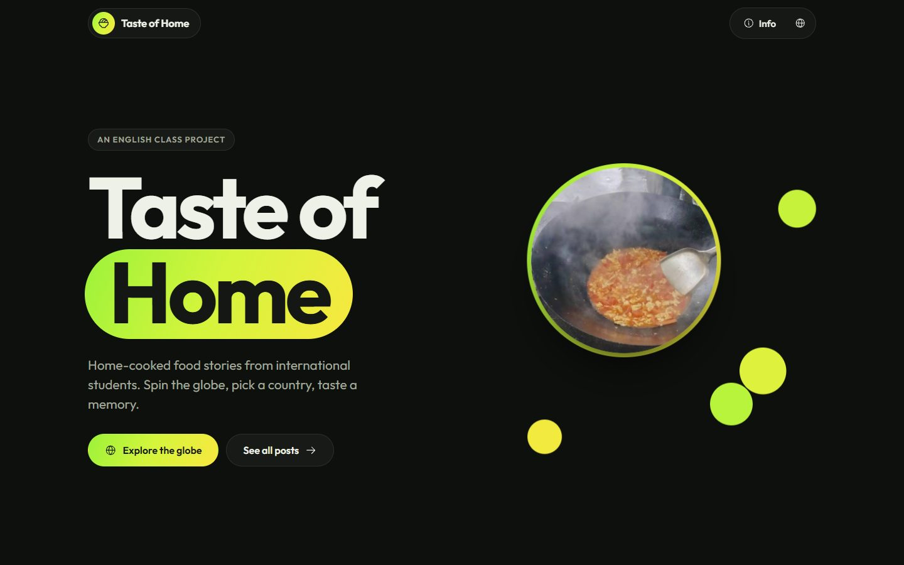
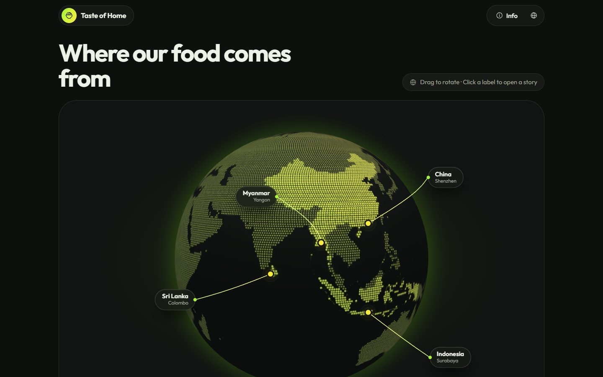
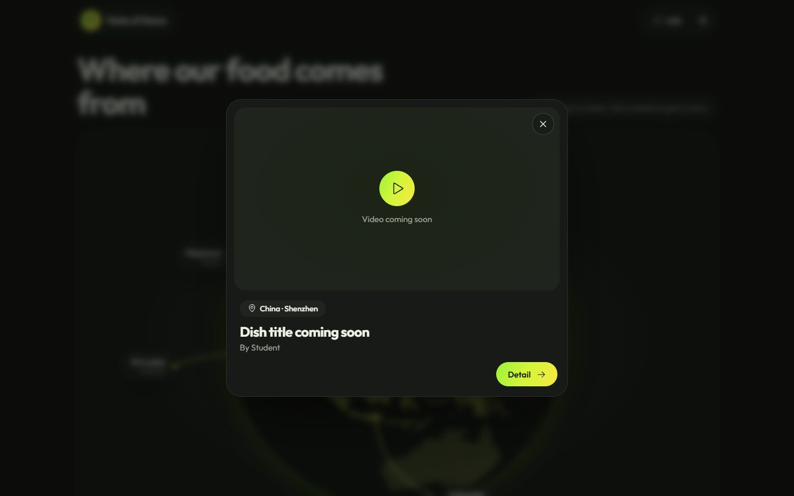
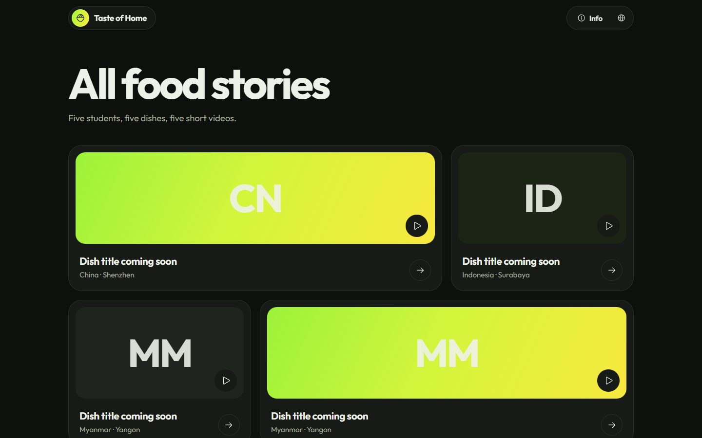
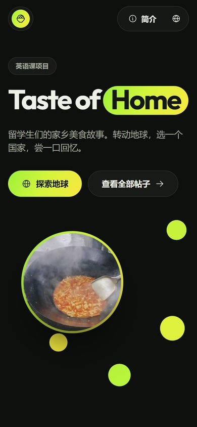

<a id="top"></a>
<div align="center">

# Taste of Home

**Home-cooked food stories from international students, on a 3D globe.**

An English class project by five students from China, Indonesia, Myanmar and Sri Lanka.

[**Visit the site →**](https://blanchexxxxx.github.io/taste-of-home/)

<a href="#english"></a>
<a href="#中文说明"></a>
<a href="#日本語"></a>



</div>

<a id="english"></a>

## What's inside

- **3D globe** you can spin left and right. It rotates slowly by itself and stops when the pointer is on the sphere or a label. Floating labels with 3D leader lines mark each student's city.
- **Story popups**: click a label to see the dish title and video, then **Detail** opens the full post.
- **Posts page** with every story, and a page per post with video, intro and story.
- **Seven languages**: English, 简体中文, 日本語, Bahasa Indonesia, မြန်မာ, සිංහල, தமிழ். The site starts in the visitor's system language (English if it isn't one of these) and remembers their choice.
- **Droplet photo cluster** on the home page: a small physics simulation where balls drift, collide softly and can be dragged. Click a ball to bring its photo up.
- **Fast everywhere**: no build step, no external CDN or web fonts (it loads fine from mainland China), the globe library loads only when you scroll near it, rendering pauses off-screen, and low-end devices get a lighter texture. Browsers without WebGL get a plain list instead of the globe.

| Globe | Story popup |
|---|---|
|  |  |

| All posts | Phone |
|---|---|
|  |  |

## Adding your post (for classmates)

Everything you need to edit is in **[`assets/js/data.js`](assets/js/data.js)**. Find your entry in `POSTS` and fill it in:

```js
{ id: 'china-shenzhen', location: 'shenzhen',
  author: 'Your name',
  title: 'Grandma\'s Tomato and Egg',
  summary: 'One or two sentences about the dish.',
  body: ['First paragraph.', 'Second paragraph.'],
  video: 'assets/videos/shenzhen.mp4',   // or an embed URL (Bilibili / YouTube)
  poster: 'assets/img/shenzhen.jpg' }    // optional cover image
```

- Anything left as `null` shows a "coming soon" placeholder.
- `title`, `summary` and `body` can also be translated: `title: { en: 'Tomato and Egg', zh: '番茄炒蛋' }`.
- **Videos**: put a compressed `.mp4` (under about 50 MB) in `assets/videos/`, or use an embed URL. YouTube is blocked in mainland China, so Bilibili or a file in the repo is safer.
- Commit and push to `main`. GitHub Pages updates the site in about a minute.

You can edit files right on GitHub (open the file, click the pencil icon) without installing anything.

### Other things you can change

| What | Where |
|---|---|
| Cities on the globe (lat/lng, label position) | `LOCATIONS` in `assets/js/data.js` |
| Home page photos (square images work best) | `HERO_PHOTOS` in `assets/js/data.js`, files in `assets/img/hero/` |
| Interface text and translations | `assets/js/i18n.js` |
| Colors, spacing, fonts | `:root` variables at the top of `assets/css/style.css` |
| Droplet physics (speed, drag, bounce) | `WANDER`, `VMAX`, `DRAG`, `BOUNCE` in `assets/js/pages.js` |
| Globe texture | regenerate with `tools/bake_globe.py` (instructions inside) |

## Run it locally

No build step. Serve the folder with any static server:

```bash
python -m http.server 8000
# then open http://localhost:8000
```

## Project structure

```
index.html            home: title, droplet photos, globe
posts.html            all posts
post.html?id=...      one post
info.html             about the project, team, credits
assets/
  css/style.css       all styles (dark theme, one accent gradient)
  js/data.js          posts, cities, home photos   ← edit this
  js/i18n.js          translations (7 languages)
  js/common.js        language switching, popup, shared helpers
  js/pages.js         home photos physics, posts grid, post page
  js/globe.js         3D globe, labels, rotation, performance
  js/icons.js         Phosphor icons (generated)
  img/  fonts/        textures, photos, Outfit font
vendor/globe.gl.min.js
tools/bake_globe.py   generates the dotted globe texture
docs/                 screenshots for this README
```

When you change CSS or JS, bump the `?v=` number on the `<link>` and `<script>` tags in the four HTML files so visitors' browsers fetch the new version instead of a cached one.

## Credits and license

The site's code is released under the [MIT License](LICENSE). Bundled libraries, the font, icons, map data and placeholder photos keep their own licenses, listed in [THIRD_PARTY_NOTICES.md](THIRD_PARTY_NOTICES.md): [globe.gl](https://github.com/vasturiano/globe.gl) (MIT), [Phosphor Icons](https://phosphoricons.com) (MIT), [Outfit](https://github.com/Outfitio/Outfit-Fonts) (OFL), [Natural Earth](https://www.naturalearthdata.com) (public domain) and photos from Wikimedia Commons (CC0 / CC BY-SA). The students' own posts, videos and photos belong to their authors.


<p align="right"><a href="#top">↑ Back to top</a></p>

---

<a id="中文说明"></a>

## 中文说明

**Taste of Home** 是我们英语课的项目网站：来自中国、印度尼西亚、缅甸和斯里兰卡的五位留学生，各自介绍一道家乡菜，配一段短视频。

网站地址：https://blanchexxxxx.github.io/taste-of-home/

### 功能

- **3D 地球**：可以左右拖动，平时缓慢自转，鼠标放在地球或标签上时停下。每位同学的城市都有一个浮在空中的标签，用立体牵引线连到地面。
- **点击标签**弹出小窗，显示菜名和视频；点 **Detail** 进入完整帖子。
- **七种语言**：English、简体中文、日本語、Bahasa Indonesia、မြန်မာ、සිංහල、தமிழ்。默认跟随电脑系统语言，不在列表里就用英语，切换后会记住。
- **首页水珠照片**：一个小型物理模拟，球会慢慢漂移、柔和地碰撞，可以用鼠标拖动；点击小球会把它的照片放大显示。
- **哪里都能流畅打开**：
  - 不需要构建，也不依赖外部 CDN 或网络字体，在国内也能正常打开；
  - 滚动到地球附近才加载地球库，离开屏幕时暂停渲染；
  - 低配设备自动使用更轻的贴图，不支持 WebGL 的浏览器会改为显示列表。

### 同学如何添加自己的帖子

只需要改 **[`assets/js/data.js`](assets/js/data.js)**：在 `POSTS` 里找到自己那一条，填上作者、标题、简介、正文和视频（格式见上面英文部分的示例）。

- 留空（`null`）的地方会显示"即将上线"。
- 视频可以把压缩后的 mp4（50MB 以内）放进 `assets/videos/`，也可以用 B 站嵌入链接。国内打不开 YouTube，不建议使用。
- 可以直接在 GitHub 网页上编辑：打开文件，点铅笔图标，改完提交即可，不需要安装任何软件。提交约一分钟后网站自动更新。

其它可修改的内容（城市坐标、首页照片、翻译、颜色、水珠物理参数、地球贴图）见上方英文部分的表格。

### 许可证

网站代码采用 [MIT 许可证](LICENSE) 开源，任何人都可以自由使用和修改。第三方的库、字体、图标、地图数据和占位照片保留各自的许可证，详见 [THIRD_PARTY_NOTICES.md](THIRD_PARTY_NOTICES.md)。同学们自己的帖子、视频和照片版权归各自作者所有。

<p align="right"><a href="#top">↑ 回到顶部</a></p>

---

<a id="日本語"></a>

## 日本語

**Taste of Home** は英語の授業のプロジェクトサイトです。中国、インドネシア、ミャンマー、スリランカから来た 5 人の留学生が、それぞれふるさとの家庭料理を短い動画と文章で紹介します。

サイト：https://blanchexxxxx.github.io/taste-of-home/

### 機能

- **3D 地球儀**：左右にドラッグして回せます。普段はゆっくり自転し、地球やラベルにマウスを置くと止まります。各学生の街には、立体的な引き出し線でつながった浮かぶラベルがあります。
- **ラベルをクリック**すると、料理名と動画の小窓が開きます。**Detail** を押すと投稿の全文が読めます。
- **7 言語対応**：English、简体中文、日本語、Bahasa Indonesia、မြန်မာ、සිංහල、தமிழ்。最初はパソコンのシステム言語で表示され（対応していない場合は英語）、切り替えた言語は記憶されます。
- **トップページの水滴写真**：小さな物理シミュレーションです。玉はゆっくり漂い、やわらかくぶつかり合い、マウスでドラッグできます。小さな玉をクリックすると、その写真が大きく表示されます。
- **どこでも軽快に表示**：
  - ビルド不要で、外部 CDN やウェブフォントにも依存しないため、中国本土からでも問題なく開けます。
  - 地球儀のライブラリは近くまでスクロールしたときに読み込み、画面外では描画を止めます。
  - 性能の低い端末では軽いテクスチャを使い、WebGL に対応していないブラウザでは一覧表示に切り替わります。

### 自分の投稿を追加する（クラスメイト向け）

編集するのは **[`assets/js/data.js`](assets/js/data.js)** だけです。`POSTS` の中から自分の項目を探し、作成者・タイトル・紹介文・本文・動画を書き込みます（書き方は英語セクションの例を参照）。

- `null` のままの項目には「近日公開」と表示されます。
- 動画は圧縮した mp4（50MB 以内）を `assets/videos/` に置くか、埋め込み URL を使います。中国本土では YouTube が見られないため、Bilibili かリポジトリ内のファイルがおすすめです。
- GitHub のウェブ画面から直接編集できます。ファイルを開いて鉛筆アイコンを押し、変更をコミットするだけで、ソフトのインストールは不要です。約 1 分後にサイトが自動で更新されます。

そのほか変更できる内容（街の座標、トップページの写真、翻訳、色、水滴の物理パラメータ、地球儀のテクスチャ）は、英語セクションの表を参照してください。

### ライセンス

サイトのコードは [MIT ライセンス](LICENSE) で公開しており、誰でも自由に使用・改変できます。同梱しているライブラリ、フォント、アイコン、地図データ、仮の写真はそれぞれのライセンスに従います。詳しくは [THIRD_PARTY_NOTICES.md](THIRD_PARTY_NOTICES.md) を参照してください。学生自身の投稿・動画・写真の著作権は、それぞれの作者に帰属します。

<p align="right"><a href="#top">↑ トップへ戻る</a></p>
